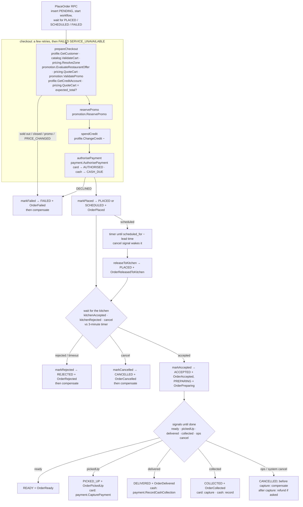

# order

The order aggregate and the **checkout saga** as a Temporal workflow (TypeScript, `@kade/order`).
Scaffolded from `services/_templates/ts`; the platform pieces (config, gRPC server, outbox,
idempotency, Kafka consumer, health) are described in that README.

- **Owns:** `orders` (the full `kade.order.v1.Order` as proto3 JSON + indexed columns), `order_refunds`,
  `group_orders`, plus the platform tables `outbox`, `processed_events`, `idempotency_keys`.
  Order numbers come from `order_number_seq` (KD-5001, …).
- **API:** `kade.order.v1.OrderService` (11 RPCs) and `GroupOrderService` (6) —
  [proto/kade/order/v1/order_service.proto](../../proto/kade/order/v1/order_service.proto).
- **Workflow:** `orderWorkflow`, workflow id = order id, namespace `kade`, task queue `order`. The worker
  runs in this process.
- **Ports:** gRPC 50107, HTTP 8107 (`/health/live`, `/health/ready` = Postgres + Kafka + Temporal worker,
  `/metrics`). **Database:** `orders` (login `order`).

## The saga



**Compensations** (`compensate()`): `payment.VoidPayment` (if authorised and not captured),
`promotion.ReleasePromo`, `profile.ChangeCredit` (+, `ORDER_SPEND_REVERSED`). They run _after_ the
decision is recorded (status first, so customers and kitchens see it at once), in parallel, with
unlimited retries for outages; a refusal (non-retryable error) is logged and doesn't fail the order.

**Signals** (`src/workflows/signals.ts`): `kitchenAccepted`, `kitchenRejected`, `cancel`, `ready`,
`pickedUp`, `delivered`, `collected`. **Query:** `state` (stage, payment id, promo reservation, credit
spent, captured). Signals are idempotent: duplicates and out-of-order late ones are ignored; a
customer cancel after the kitchen accepted is ignored (the RPC answers `ORDER_ALREADY_STARTED`).

**Timers:** the accept window (`ACCEPT_TIMEOUT_SECONDS`, 180) and the scheduled-order release
(`scheduled_for − lead`, lead = the restaurant's max ETA for delivery, `max(10, min ETA − 5)` for pickup).

**Idempotency keys** sent to dependencies: `order:<id>:promo`, `order:<id>:credit`,
`order:<id>:credit:reverse`, `order:<id>:authorise`, `order:<id>:void`, `order:<id>:capture`,
`order:<id>:cash`, `order:<id>:tip:<key>`, `order:<id>:refund:<key>`.

Capture and cash recording run alongside the workflow's next steps (a slow payment service never
holds back DELIVERED); the workflow waits for them before it completes.

### Watch it in the Temporal UI

1. http://localhost:8233/namespaces/kade/workflows — every order is a workflow whose id is the order id.
2. Open one: the **History** shows each activity (`prepareCheckout`, `authorisePayment`, `markPlaced`, …),
   the `TimerStarted` for the 3-minute window and each signal as it arrives.
3. **Queries → state** shows where the saga is. From the CLI:
   `docker compose -f deploy/compose/compose.yaml exec temporal-admin-tools temporal workflow list -n kade`.

### Drive it by hand: `scripts/saga.ts`

Plays the kitchen and the rider by producing their events onto Kafka (or calls the real merchant):

```sh
cd services/order
node scripts/saga.ts run                    # place a card order and walk it to DELIVERED
node scripts/saga.ts run --cash --promo KADE100
node scripts/saga.ts run --pickup
node scripts/saga.ts place --decline        # card ending 0002 → PAYMENT_DECLINED (payment stub)
node scripts/saga.ts place                  # then let it sit 3 minutes → REJECTED (TIMEOUT)
node scripts/saga.ts kitchen accept <orderId>   # through merchant.KitchenService (live merchant)
node scripts/saga.ts get KD-5001
```

## Dependency modes (`<NAME>_MODE=grpc|stub`)

Every dependency is behind a port (`src/clients/ports.ts`) with a gRPC adapter (deadline
`GRPC_CLIENT_DEADLINE_MS`, 2 s; reads retried twice; writes retried by Temporal with idempotency
keys) and an in-process stub (`src/clients/stubs.ts`). Default is `grpc`.

| Setting          | Address                  | Stub behaviour                                                                                                                                  |
| ---------------- | ------------------------ | ----------------------------------------------------------------------------------------------------------------------------------------------- |
| `CATALOG_MODE`   | `CATALOG_GRPC` (50101)   | every dish Rs 1,000; item id containing `soldout` is sold out                                                                                   |
| `PROFILE_MODE`   | `PROFILE_GRPC` (50103)   | everyone exists, not blocked, no Plus; credit in memory (starts at 0)                                                                           |
| `PRICING_MODE`   | `PRICING_GRPC` (50105)   | totals.ts formula, flat Rs 150 delivery, Rs 60 small-order fee under Rs 500; (0,0) is out of zone                                               |
| `PROMOTION_MODE` | `PROMOTION_GRPC` (50106) | `KADE100` (Rs 100 off from Rs 1,000), `FIRSTKOTTU` (15% up to Rs 500, restaurant 1); no automatic offers (catalog's `discount_percent` applies) |
| `PAYMENT_MODE`   | `PAYMENT_GRPC` (50108)   | card ending `0002` DECLINED, other cards AUTHORISED, cash CASH_DUE; capture/void/refund succeed                                                 |

Dispatch is never called (choreography over `kade.delivery.events`); merchant is never called (its
events drive the workflow). Without them, `scripts/saga.ts` plays their part.

The Compose fragment defaults to **catalog/profile/pricing = grpc, promotion/payment = stub**,
overridable with `ORDER_<NAME>_MODE` (e.g. `ORDER_PAYMENT_MODE=grpc`).

## Events

**Out** (`kade.order.events`, aggregatetype `order`, key = order id; group events key = group id):
`OrderPlaced`, `OrderReleasedToKitchen`, `OrderAccepted`, `OrderPreparing`, `OrderRejected`,
`OrderReady`, `OrderRiderChanged`, `OrderPickedUp`, `OrderDelivered`, `OrderCollected`, `OrderCancelled`,
`OrderFailed`, `OrderTipUpdated`, `OrderRefunded`, `GroupOrderUpdated`. All through the outbox, in the
same transaction as the change.

**In** (group `order`, deduplicated in `processed_events`):

| Event                                                     | Effect                                                           |
| --------------------------------------------------------- | ---------------------------------------------------------------- |
| `kade.merchant.v1.TicketAccepted` / `TicketRejected`      | `kitchenAccepted` / `kitchenRejected` signal                     |
| `kade.merchant.v1.TicketReady`                            | `ready` signal                                                   |
| `kade.merchant.v1.TicketHandedOver`                       | `collected` signal (pickup orders only)                          |
| `kade.dispatch.v1.DeliveryRequested`                      | stores `delivery_id`                                             |
| `kade.dispatch.v1.RiderAssigned` / `RiderUnassigned`      | stores the rider + `OrderRiderChanged` (no workflow involvement) |
| `kade.dispatch.v1.DeliveryPickedUp` / `DeliveryCompleted` | `pickedUp` / `delivered` signal                                  |
| `kade.dispatch.v1.DeliveryMatchingFailed`                 | `cancel` signal (system, fault KADE, refund)                     |

`kade.payment.events` is not consumed yet (the workflow gets payment outcomes synchronously).

## RPC rules worth knowing

- **PlaceOrder** needs `idempotency_key`; the same key with the same body returns the same order (or
  the same failure); a different body → `FAILED_PRECONDITION IDEMPOTENCY_KEY_REUSED`. It waits up to
  `PLACE_ORDER_WAIT_MS` (20 s) for the saga; failures carry the saga's reason (`CART_EMPTY`,
  `ADDRESS_REQUIRED`, `OUT_OF_ZONE`, `RESTAURANT_CLOSED`, `ITEM_SOLD_OUT`, `ITEM_OPTIONS_INVALID`,
  `PRICE_CHANGED`, `PROMO_*`, `PAYMENT_DECLINED`, `CUSTOMER_BLOCKED`; outages → `UNAVAILABLE`
  `SERVICE_UNAVAILABLE`).
- **CancelOrder**: customers only from SCHEDULED/PLACED (`ORDER_ALREADY_STARTED`); ops/system from any
  non-final status, `refund` refunds what was captured (card → card, credit spent and cash → credit).
- **UpdateTip**: card + delivery only (`CASH_TIP_AT_DOOR`, `TIP_DELIVERY_ONLY`), until the card is
  captured at pickup (`TIP_LOCKED`); adjusts the authorisation.
- **RefundOrder**: staff (`ops`, `admin`, `support`, `finance`) or internal callers; at most what's left
  (`REFUND_EXCEEDS_REMAINING`), card only for card orders (`CASH_ORDER_REFUND_TO_CREDIT`).
- **Access:** calls without `x-user-id` are trusted service calls; staff roles see everything; customers
  only their orders; merchant staff their outlet's (`x-outlet-id`); others get `NOT_FOUND`.
- **Group orders:** `GetGroupOrder` → `NOT_FOUND GROUP_CLOSED` once placed/closed; per-person limit
  → `GROUP_LIMIT_EXCEEDED`; placing an order with `group_id` marks the group PLACED.

## Run alone

```sh
pnpm infra:up
cp services/order/.env.example services/order/.env      # stubs for promotion and payment
pnpm --filter @kade/order dev
deploy/compose/connect/register-outbox.sh order orders   # once, after the first start
```

In Compose: `docker compose -f deploy/compose/compose.yaml --profile ordering up -d --build order`
(the fragment must be listed in `deploy/compose/services.yaml`). The image is Debian (glibc): the
Temporal worker's native core does not run on Alpine/musl.

`SEED_DEMO_ORDERS=true` inserts dilini's demo history (KD-4821, KD-3307, KD-2954, KD-2410).

## Test

```sh
pnpm --filter @kade/order test               # unit + workflow (Temporal time-skipping test server)
pnpm --filter @kade/order test:integration   # shared stack: Postgres, Kafka, Temporal (stubs for services)
```

The workflow tests fake every activity and cover: card and cash happy paths, pickup, kitchen reject,
kitchen timeout, late accept, cancel before accept, ops cancel after pickup (refund), payment
declined, validation failure, scheduled orders (sleep, release, cancel while asleep) and a checkout
outage. The integration test runs the real saga on a private task queue with Kafka-delivered kitchen
and rider events.
